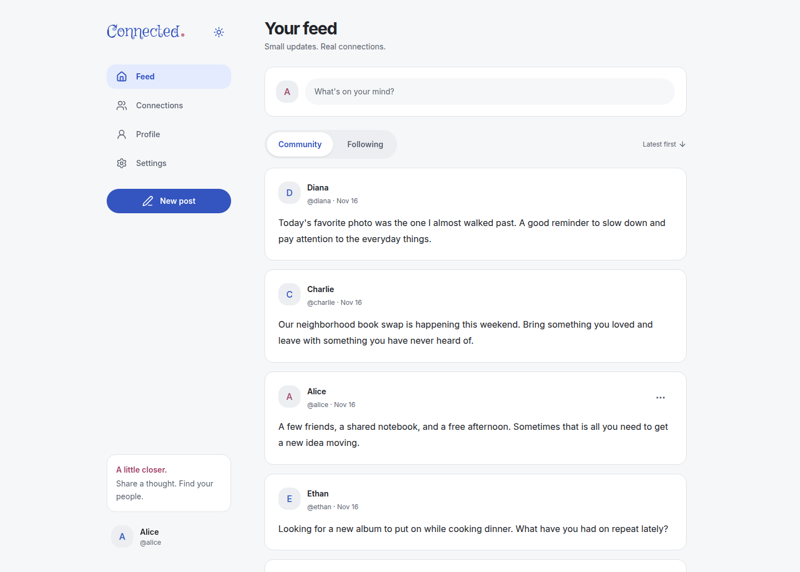
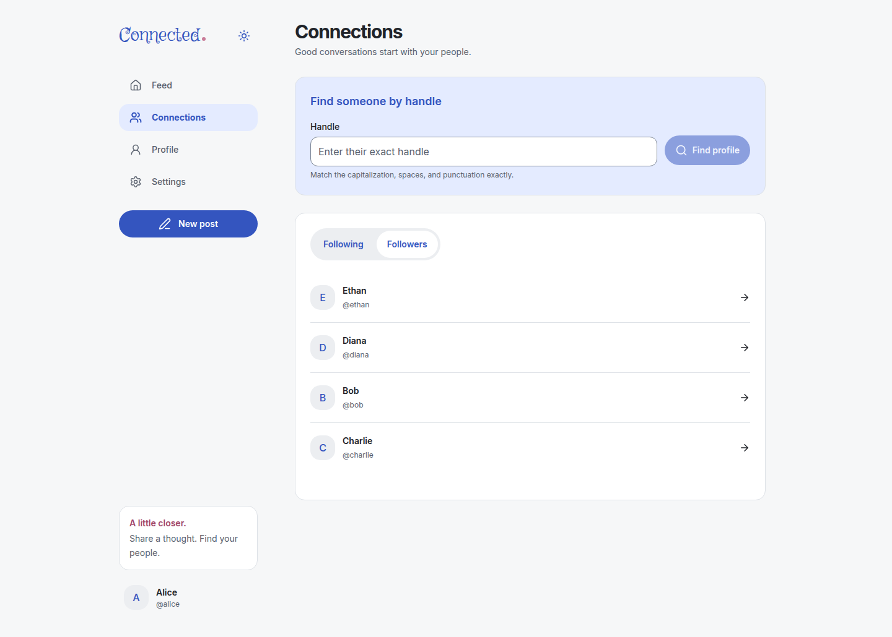

# Connected

Share updates, follow people, and keep up with your community.

## Screenshots

### Community feed

Browse recent posts or switch to updates from people you follow.



### Profile

View someone's posts and follow or unfollow them.


### Connections

Find someone by handle and see your following and followers lists.



## Run locally

Run the development containers from the repository root:

```bash
cp -n .env.example .env
cp -n services/identity/.env.example services/identity/.env
```

For a fresh setup, set `JWT_PRIVATE_KEY` in `services/identity/.env` to an unencrypted RSA private key in PEM format, at least 2048 bits. Keep an existing identity `.env` if one is already configured.

```bash
docker compose -f docker-compose.dev.yml up -d
```

Use `-f docker-compose.dev.yml` for all development Compose commands, including `logs`, `exec`, and `down`.
