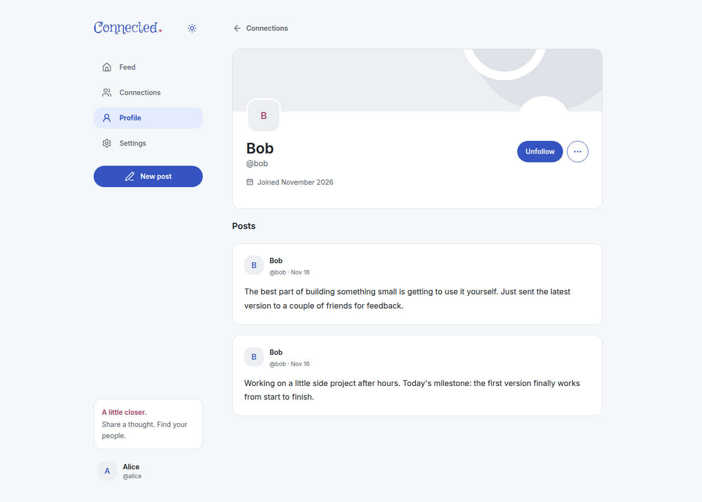
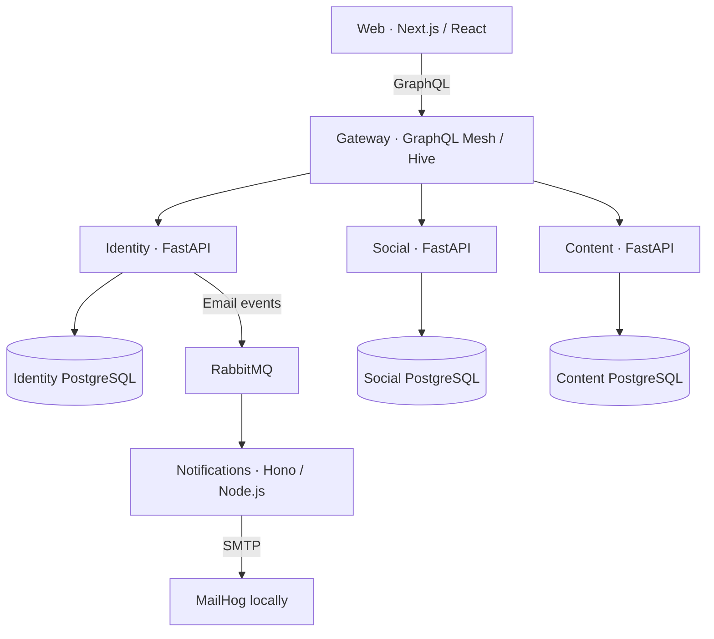

<h1 align="center">Connected</h1>

<p align="center">
  Share updates, find your people, and keep up with your community.
</p>

<p align="center">
  A full-stack social app with a Next.js frontend, a GraphQL gateway,<br />
  and separate services for identity, social relationships, content, and email.
</p>

<p align="center">
  <a href="#the-app">The app</a> &middot;
  <a href="#architecture">Architecture</a> &middot;
  <a href="#engineering-decisions">Engineering decisions</a> &middot;
  <a href="#run-locally">Run locally</a> &middot;
  <a href="#code-tour">Code tour</a>
</p>


## The app

Connected is a portfolio project built around the parts of a social app that need to work together. Accounts, relationships, posts, and email each have an explicit owner. The browser uses one GraphQL endpoint.

- Sign up, verify your email, log in, and recover your account through a password-reset link.
- Create a profile with a unique handle and edit your display name.
- Publish text posts, open individual posts, and delete your own posts.
- Browse the community feed or switch to posts from people you follow and your own updates.
- Find people by exact handle, follow or unfollow them, view your follower lists, and manage blocked accounts.
- Use light or dark mode and layouts that adapt to mobile and desktop.

<details>
  <summary>See profiles and connections</summary>
  <br />
  <table>
    <tr>
      <th width="50%">Profile</th>
      <th width="50%">Connections</th>
    </tr>
    <tr>
      <td></td>
      <td></td>
    </tr>
  </table>
</details>

## Architecture



The gateway composes the Python services' OpenAPI contracts into a GraphQL schema. It forwards authentication and maps service errors for the client. Identity, Social, and Content each own a PostgreSQL database. Social and Content ask Identity to verify the current account, and Content asks Social which authors the viewer can see.

The service split is a learning choice. It makes data ownership and failure handling explicit, at the cost of more processes and network calls than a single backend.

| Layer              | Technologies                                                                 |
| ------------------ | ---------------------------------------------------------------------------- |
| Web                | Next.js App Router, React, TypeScript, Chakra UI, urql, React Hook Form, Zod |
| API gateway        | GraphQL Mesh, Hive Gateway, OpenAPI composition                              |
| Domain services    | Python, FastAPI, Pydantic, async SQLAlchemy, asyncpg                         |
| Data and messaging | PostgreSQL, Alembic, RabbitMQ                                                |
| Email              | Node.js, Hono, React Email, Nodemailer, MailHog                              |
| Development        | Docker Compose, pnpm, uv                                                     |

## Engineering decisions

- **Rotating sessions.** Identity hashes passwords with Argon2 and issues signed access JWTs. Refresh tokens live in HttpOnly cookies. Reuse of a consumed refresh token revokes its login family. See [session handling](services/identity/src/connected_identity/services/sessions.py).
- **Transactional relationships.** Follow and block operations lock the affected profiles in a consistent order. Blocking removes follows in both directions in the same transaction. See [relationship handling](services/social/src/connected_social/services/relationships.py).
- **Block-aware feeds.** Content pages through posts with a timestamp-and-ID cursor, then asks Social to filter authors by visibility and follow status. Filtering can produce a short or empty page with another page available. See [feed routes](services/content/src/connected_content/routers/api_v1/posts.py).
- **Recoverable email delivery.** Identity stores encrypted pending delivery data in PostgreSQL and retries publication to RabbitMQ. Notifications acknowledges mail after SMTP success, or after confirmed transfer to a delayed retry or failed-delivery queue. Delivery is at least once, so duplicates remain possible. See the [publisher worker](services/identity/src/connected_identity/jobs.py) and [email consumer](services/notifications/src/consumers/email-consumer.ts).
- **Generated client operations.** GraphQL Code Generator produces typed operations and urql hooks from the gateway schema and the web app's GraphQL documents. See the [codegen configuration](apps/web/codegen.yml).

## Run locally

Install Docker with Compose, Node.js 24 or newer, pnpm 12.18.0, and OpenSSL. Docker runs the backend services and infrastructure. Run the gateway and web app on the host.

### 1. Configure the environment

Clone the repository and copy the development settings. Keep existing `.env` files if you have already configured them.

```bash
git clone https://github.com/sreekarnv/connected.git
cd connected
cp -n .env.example .env
cp -n services/identity/.env.example services/identity/.env
cp -n apps/web/.env.example apps/web/.env
```

Generate a local signing key:

```bash
openssl genpkey -algorithm RSA -pkeyopt rsa_keygen_bits:2048
```

In `services/identity/.env`, set `JWT_PRIVATE_KEY` to the entire PEM output, including the `BEGIN` and `END` lines. Wrap the value in double quotes and preserve its newlines. Keep this key in the ignored `.env` file.

### 2. Start the backend services

From the repository root:

```bash
docker compose -f docker-compose.dev.yml up -d --wait
```

The Python services apply Alembic migrations on startup. The first run also downloads images and installs service dependencies.

Prometheus starts with the stack and collects service metrics. Open <http://localhost:9090/targets> to check the scrape targets; the gateway target becomes available after the next step.

### 3. Start the gateway

In a separate terminal, from the repository root:

```bash
cd apps/gateway
pnpm install --frozen-lockfile
pnpm compose
HOST=0.0.0.0 pnpm dev
```

Keep the gateway running. Run `pnpm compose` again after backend API contract changes, then restart the gateway.

### 4. Start the web app

In another terminal, from the repository root:

```bash
cd apps/web
pnpm install --frozen-lockfile
pnpm dev
```

Open [Connected](http://localhost:3000). Create an account, open [MailHog](http://localhost:8025), and follow the verification link. Log in and create your profile. Use a second account to try follows and the Following feed.

| Local endpoint    | Address                         |
| ----------------- | ------------------------------- |
| Web app           | <http://localhost:3000>         |
| GraphQL gateway   | <http://localhost:4000/graphql> |
| Identity API docs | <http://localhost:4001/docs>    |
| Social API docs   | <http://localhost:4003/docs>    |
| Content API docs  | <http://localhost:4004/docs>    |
| Development inbox | <http://localhost:8025>         |
| Prometheus targets | <http://localhost:9090/targets> |

To inspect backend startup or stop the containers, run these commands from the repository root:

```bash
docker compose -f docker-compose.dev.yml logs -f
docker compose -f docker-compose.dev.yml down
```

Stop the gateway and web terminals with `Ctrl+C`. Compose keeps database data in named volumes when you run `down`.

## Code tour

| Directory                                        | Responsibility                                                                               |
| ------------------------------------------------ | -------------------------------------------------------------------------------------------- |
| [apps/web](apps/web)                             | Account pages, feeds, profiles, connections, and generated GraphQL operations                |
| [apps/gateway](apps/gateway)                     | OpenAPI composition, GraphQL schema extensions, authentication forwarding, and error mapping |
| [services/identity](services/identity)           | Accounts, email verification, sessions, password recovery, and pending email delivery        |
| [services/social](services/social)               | Profiles, follows, blocks, and visibility rules                                              |
| [services/content](services/content)             | Posts, owner-only deletion, and cursor-based feeds                                           |
| [services/notifications](services/notifications) | Email templates, RabbitMQ consumers, SMTP delivery, and retry queues                         |

## Project scope

The current app covers text posts and social relationships. Media uploads, likes, comments, direct messages, and an in-app notification inbox are outside the current scope. Notifications handles account email.

Each application has a production Dockerfile and health endpoints. Hosting, HTTPS ingress, managed infrastructure, and staging acceptance remain deployment work. Focused telemetry tests cover request instrumentation and email delivery outcomes. See [logging and metrics](docs/OBSERVABILITY.md) for collection and test commands.

## License

[MIT](LICENSE). Copyright 2026 Sreekar Nutulapati.
